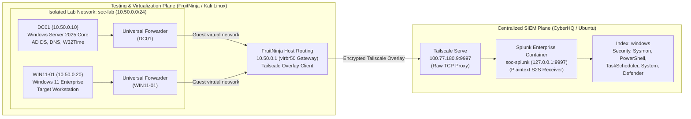

# Lab Architecture

This document describes the physical, virtual, and network architecture of the Windows Detection Engineering Lab. The environment executes controlled adversary emulation in an Active Directory domain, captures high-fidelity telemetry across operating system event channels, and centralizes logs into an independent Splunk Enterprise instance over an encrypted overlay network.

---

## 1. Architectural Overview

The environment separates the virtualization and adversary-emulation platform from the centralized SIEM infrastructure across two dedicated physical systems:

- **Testing & Virtualization Plane (`FruitNinja`):** A physical Linux host running KVM/QEMU/libvirt managing an isolated virtual network (`soc-lab`, `10.50.0.0/24`) hosting the domain controller (`DC01`) and target workstation (`WIN11-01`). Controlled MITRE ATT&CK behaviors execute within this plane.
- **Centralized SIEM Plane (`CyberHQ`):** An independent physical Linux host running containerized Splunk Enterprise. It acts solely as an analysis and indexing platform, separated from the virtualization boundary to prevent resource contention or accidental coupling between workload execution and log analysis.
- **Telemetry Ingestion Pipeline:** Splunk Universal Forwarders on `DC01` and `WIN11-01` stream Windows event channels over the virtual bridge network to FruitNinja, which routes traffic through an encrypted Tailscale overlay network to CyberHQ. Tailscale Serve on CyberHQ accepts incoming traffic on `100.77.180.9:9997` and proxies the raw TCP stream to the local Splunk receiver on `127.0.0.1:9997`.



---

## 2. Physical & Virtual Systems

### CyberHQ (SOC / SIEM Host)
- **Role:** Centralized SIEM and security log analysis host.
- **Operating System:** Ubuntu 26.04 LTS.
- **Service Configuration:** Containerized Splunk Enterprise (`soc-splunk`, restart policy: `always`).
- **Telemetry Ingestion:** Listens locally on `127.0.0.1:9997`, published across the secure Tailnet via Tailscale Serve on `100.77.180.9:9997`.
- **Storage:** Dedicated `windows` index for all lab telemetry.

### FruitNinja (Virtualization & Emulation Host)
- **Role:** Hypervisor host and controlled adversary emulation platform.
- **Operating System:** Kali Linux 2026.1.
- **Virtualization Stack:** KVM, QEMU, libvirt, virt-manager, virt-install, OVMF (UEFI), swtpm (TPM 2.0).
- **Network Interface:** Virtual bridge `virbr50` acting as default gateway (`10.50.0.1`) for the lab subnet.

### DC01 (Domain Controller)
- **Role:** Active Directory Domain Controller, DNS server (`soclab.test` / `SOCLAB`), and authoritative domain time source.
- **Operating System:** Windows Server 2025 Standard Evaluation Server Core (Build 26100.1742).
- **Compute:** 2 vCPU, 2.5 GiB RAM, 50 GiB thin-provisioned qcow2 disk.
- **Network:** Static IPv4 `10.50.0.10/24`, Gateway `10.50.0.1`, DNS client `10.50.0.10`.
- **Time Synchronization:** W32Time configured with external NTP peer `time.windows.com,0x8` (Stratum 5).
- **Telemetry Stack:** Microsoft Sysinternals Sysmon v15.22 (`Sysmon64`, schema `4.91`), Advanced Audit Policies enabled, PowerShell ScriptBlock Logging enabled, Splunk Universal Forwarder running as `LocalSystem`.

### WIN11-01 (Target Workstation)
- **Role:** Primary domain-joined workstation (`WIN11-01.soclab.test`) and detection target endpoint.
- **Operating System:** Windows 11 Enterprise Evaluation 26H2 (Build 26300.9457).
- **Compute:** 4 vCPU, 4 GiB RAM, 80 GiB thin-provisioned qcow2 disk, UEFI, software TPM 2.0.
- **Network:** Static IPv4 `10.50.0.20/24`, Gateway `10.50.0.1`, DNS `10.50.0.10`.
- **Time Synchronization:** W32Time domain hierarchy synchronization against `DC01.soclab.test` (Stratum 6, sub-second alignment).
- **Telemetry Stack:** Windows native built-in Sysmon (`Sysmon`, schema `4.91`), Advanced Audit Policies enabled, PowerShell ScriptBlock and Module logging enabled, Windows Task Scheduler operational logging, Splunk Universal Forwarder running as `NT SERVICE\SplunkForwarder`.

---

## 3. Network Segmentation & Transport Boundaries

- **Subnet:** `10.50.0.0/24` on dedicated bridge `virbr50`.
- **Gateway:** `10.50.0.1` (FruitNinja host interface).
- **Address Allocations:**
  - `10.50.0.10` — `DC01` (Static)
  - `10.50.0.20` — `WIN11-01` (Static)
  - `10.50.0.100`–`10.50.0.199` — Dynamic DHCP range.
- **NAT Topology:** Windows guests reside on the libvirt NAT-backed `soc-lab` network rather than being directly bridged onto the local LAN. The default topology does not provide an inbound route from the LAN to the guests. NAT affects addressing and reachability but is not treated as a security boundary.
- **Forwarder Routing & Transport:** Windows virtual machines do not run Tailscale directly. Splunk telemetry targets CyberHQ port 9997, routing through the FruitNinja host gateway. FruitNinja forwards traffic across the encrypted host-to-host Tailscale overlay. Tailscale Serve on CyberHQ accepts incoming connections on `100.77.180.9:9997` and proxies the raw TCP stream to the containerized Splunk indexing daemon on `127.0.0.1:9997`. Separate Splunk S2S TLS is not enabled.

---

## 4. Telemetry Pipeline Architecture

```text
[ Windows Event Providers: Security, System, Sysmon, PowerShell, TaskScheduler, Defender ]
                                    │
                                    ▼
       [ Splunk Universal Forwarder on DC01 / WIN11-01 (Standard S2S) ]
                                    │
                    (Guest Virtual Network: virbr50)
                                    ▼
       [ FruitNinja Host Routing & Encrypted Tailscale Overlay Transport ]
                                    │
                    (Host-to-Host Tailscale Overlay)
                                    ▼
              [ CyberHQ Tailscale Serve Proxy (100.77.180.9:9997) ]
                                    │
                             (Raw TCP Proxy)
                                    ▼
             [ Containerized Splunk Receiver (127.0.0.1:9997) ]
                                    │
                                    ▼
                    [ Dedicated "windows" Index Pipeline ]
                                    │
                                    ▼
                [ Search, Analytics & Telemetry Correlation ]
```

Six primary event channels are actively forwarded from each target system:
1. `Wineventlog:Security` (Windows Security Auditing)
2. `Wineventlog:System` (System events and service operations)
3. `Wineventlog:Microsoft-Windows-Sysmon/Operational` (Process creation, file modification, registry state changes)
4. `Wineventlog:Microsoft-Windows-PowerShell/Operational` (ScriptBlock EventID 4104, Module EventID 4103)
5. `Wineventlog:Microsoft-Windows-TaskScheduler/Operational` (Task registration, update, deletion)
6. `Wineventlog:Microsoft-Windows-Windows Defender/Operational` (Endpoint antimalware activity)

---

## 5. Security & Isolation Controls

1. **Standard-User Execution Context:** Adversary behaviors are executed under standard domain user `SOCLAB\employee01` (Medium Mandatory Level `S-1-16-8192`, `IsAdminRole = False`), ensuring realistic enterprise telemetry without artificial administrative elevation.
2. **Deterministic Time Hierarchy:** DC01 PDC emulator synchronizes with external authoritative NTP (`time.windows.com`), and WIN11-01 synchronizes against DC01 via the domain hierarchy, achieving sub-second clock synchronization (< 0.4s offset) to support reliable cross-host temporal correlation.
3. **Artifact Cleanup & Negative-State Verification:** Tests that create persistent or transient artifacts execute verified cleanups, returning the endpoint to a clean baseline state.
