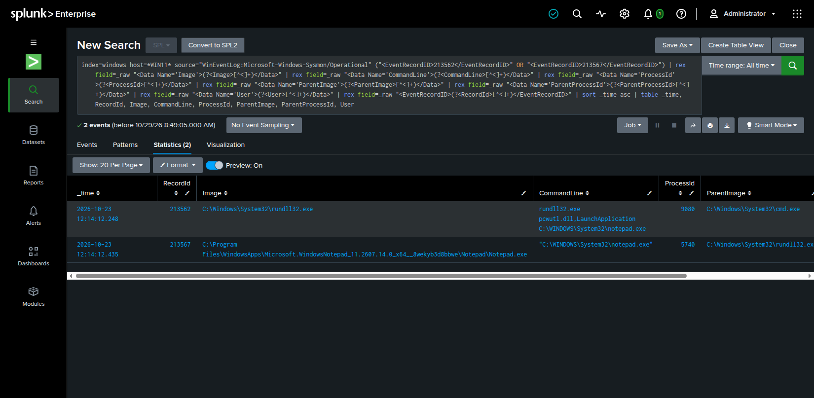
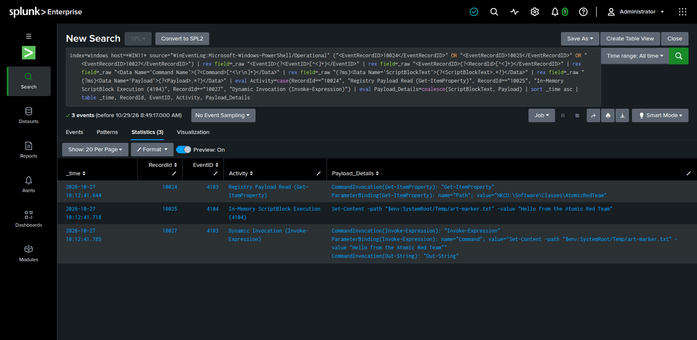
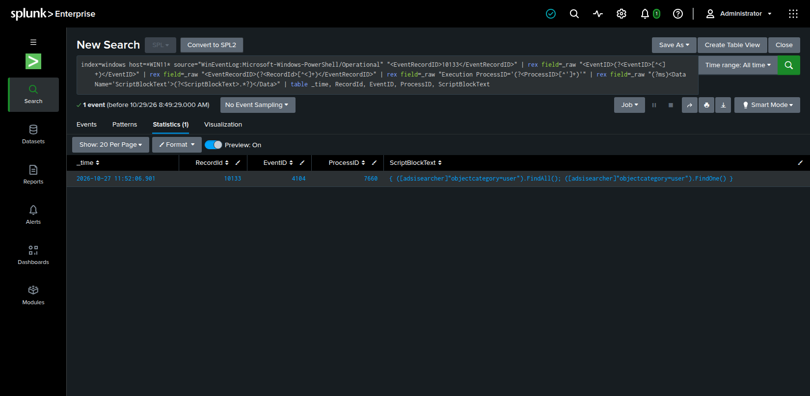
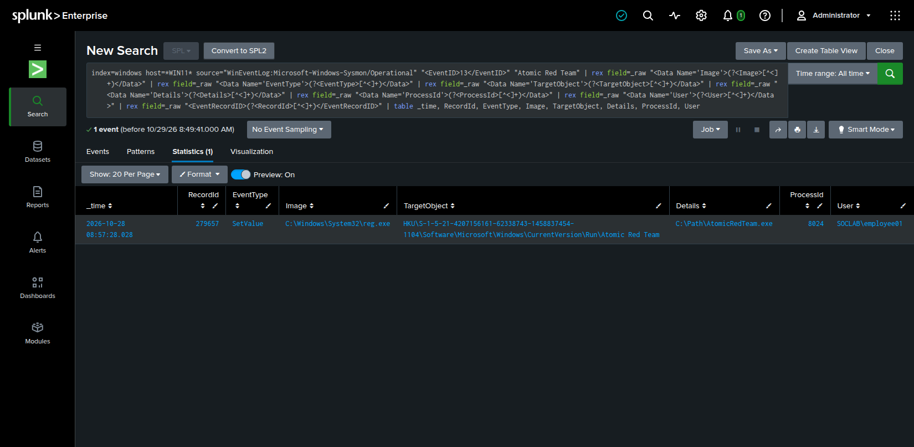

# Case Studies

Five ATT&CK-mapped scenarios showing the activity performed, the Windows telemetry captured, and the corresponding Splunk analysis.

---

## T1218.011 — Rundll32 Proxy Execution

- **Activity:** `rundll32.exe pcwutl.dll,LaunchApplication` launched `notepad.exe` under a standard domain user.
- **Telemetry:** Sysmon Event 1 captured the direct `rundll32.exe` → `notepad.exe` process lineage.
- **Splunk:** [View query](splunk/rundll32-proxy-execution.spl)
- **Supporting records:** [Execution](evidence/rundll32-proxy-execution/execution.md) · [Splunk validation](evidence/rundll32-proxy-execution/splunk-validation.md)

---

## T1059.001 — PowerShell Fileless Execution

- **Activity:** An encoded command staged locally in the registry was retrieved, Base64-decoded, and dynamically evaluated in memory through `Invoke-Expression`.
- **Telemetry:** PowerShell 4104 and 4103 captured the ScriptBlock, registry retrieval, and dynamic execution chain.
- **Splunk:** [View query](splunk/powershell-fileless-execution.spl)
- **Supporting records:** [Execution](evidence/powershell-fileless-execution/execution.md) · [Splunk validation](evidence/powershell-fileless-execution/splunk-validation.md)

---

## T1087.002 — Active Directory Account Discovery

- **Activity:** A standard domain user executed PowerShell ADSISearcher with `FindAll()` and `FindOne()` to enumerate domain user accounts.
- **Telemetry:** PowerShell 4104 captured the discovery commands, and domain controller security logging correlated the directory access flow.
- **Splunk:** [View query](splunk/ad-account-discovery.spl)
- **Supporting records:** [Execution](evidence/ad-account-discovery/execution.md) · [Splunk validation](evidence/ad-account-discovery/splunk-validation.md)

---

## T1547.001 — Run-Key Persistence

- **Activity:** A persistence value was added to the current user's `CurrentVersion\Run` registry key via `reg.exe`.
- **Telemetry:** Sysmon Event 13 recorded the SetValue state change and correlated directly with the responsible process.
- **Splunk:** [View query](splunk/run-key-persistence.spl)
- **Supporting records:** [Execution](evidence/run-key-persistence/execution.md) · [Splunk validation](evidence/run-key-persistence/splunk-validation.md)

---

## T1053.005 — Scheduled-Task Persistence

- **Activity:** A standard domain user created a scheduled task configured to decode and execute a registry-staged command. The test validates task creation; the scheduled action was intentionally not triggered.
- **Telemetry:** Windows Security Event 4698 preserved the complete task XML definition, execution parameters, and creator process ID.
- **Splunk:** [View query](splunk/scheduled-task-persistence.spl)
- **Supporting records:** [Execution](evidence/scheduled-task-persistence/execution.md) · [Splunk validation](evidence/scheduled-task-persistence/splunk-validation.md)
