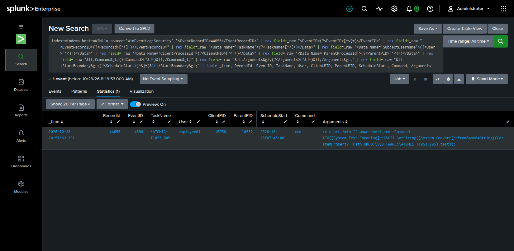
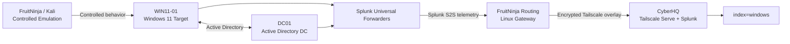

# Windows Detection Engineering Lab

Active Directory · Splunk · Sysmon · PowerShell · MITRE ATT&CK

Built a Windows Active Directory security lab, centralized endpoint telemetry in Splunk, and validated five MITRE ATT&CK-mapped behaviors using real Windows events and cross-source correlation.

**5 ATT&CK-mapped behaviors · 6 telemetry channels · 2 Windows hosts · 1 Splunk SIEM**

---

*Scheduled-task creation captured in Splunk from Windows Security Event 4698.*

[View case studies →](CASE_STUDIES.md)

---

## Scenarios Investigated

| Scenario | What happened | How I found it | Key signal | Details |
| :--- | :--- | :--- | :--- | :--- |
| **Rundll32 Proxy Execution — T1218.011** | A trusted Windows binary was used to launch another program through pcwutl.dll. | I traced the process tree in Splunk and saw rundll32.exe directly spawn notepad.exe. | Sysmon Event 1 | [Case study](CASE_STUDIES.md#t1218011--rundll32-proxy-execution) · [SPL](splunk/rundll32-proxy-execution.spl) |
| **PowerShell Fileless Execution — T1059.001** | PowerShell retrieved an encoded command from the registry, decoded it, then executed it in memory. | I correlated PowerShell ScriptBlock and pipeline logs showing the registry read, decoded script, and Invoke-Expression. | PowerShell 4104 + 4103 | [Case study](CASE_STUDIES.md#t1059001--powershell-fileless-execution) · [SPL](splunk/powershell-fileless-execution.spl) |
| **AD Account Discovery — T1087.002** | A normal domain user queried Active Directory to enumerate domain accounts. | Splunk captured the ADSISearcher command containing FindAll() and FindOne(). | PowerShell 4104 | [Case study](CASE_STUDIES.md#t1087002--active-directory-account-discovery) · [SPL](splunk/ad-account-discovery.spl) |
| **Run-Key Persistence — T1547.001** | A value was added to the current user's Run key so a program could start automatically at logon. | I found the registry SetValue event and tied it back to reg.exe. | Sysmon Event 13 | [Case study](CASE_STUDIES.md#t1547001--run-key-persistence) · [SPL](splunk/run-key-persistence.spl) |
| **Scheduled-Task Persistence — T1053.005** | A user created a scheduled task configured to execute a registry-backed PowerShell command. | Windows Security logging preserved the task definition and the process that created it. | Security 4698 | [Case study](CASE_STUDIES.md#t1053005--scheduled-task-persistence) · [SPL](splunk/scheduled-task-persistence.spl) |

---

## Lab Architecture

> **Telemetry path:** Windows Universal Forwarders → FruitNinja routing → encrypted Tailscale overlay → CyberHQ Tailscale Serve → local Splunk receiver (`index=windows`). Windows VMs do not run Tailscale; separate Splunk S2S TLS is not enabled. [Full architecture →](ARCHITECTURE.md)

---

[Case studies](CASE_STUDIES.md) · [Splunk queries](splunk/) · [Architecture](ARCHITECTURE.md) · [Lab configuration](lab/) · [Evidence](evidence/)
